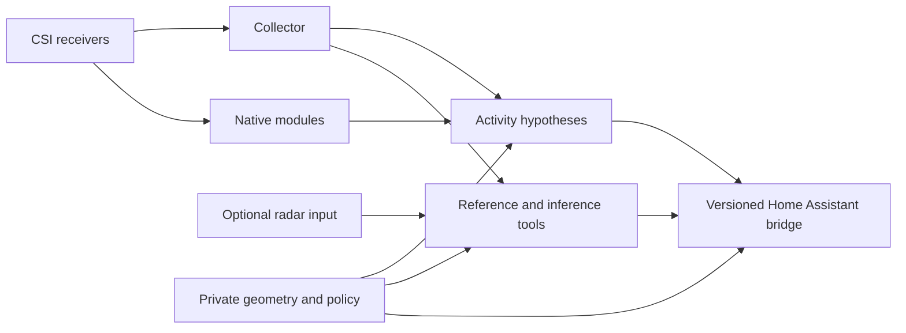

# Architecture and release boundaries

Public source owns algorithms, validation mechanisms, synthetic tests and generic build recipes. A private installation owns identities, approved policies, geometry, firmware selections, operator decisions and evidence. It consumes immutable source artifacts; it must not maintain copied application implementations.

A release consists of a source revision and a deterministic source-tools archive with a file inventory and hashes. Deployment locks pin the selected revision and verified artifacts. A candidate file cannot approve itself: independent approved hashes remain required for site context, installation policy and module manifests. Do not point a production deployment at a moving branch.

The UI template can display geometry supplied by an operator. A derived image built with that geometry is private. Public build artifacts must contain only generic templates or independently fictional examples. A public source archive is not a certification of a built firmware, container or trained model.

Changes to a deployed image, firmware, policy or placement need their own acceptance evidence. Passing software CI does not transfer an old installation's qualification to a new binary or placement. Terraform roots and state belong to installation repositories; source extraction does not require moving their resource addresses.
