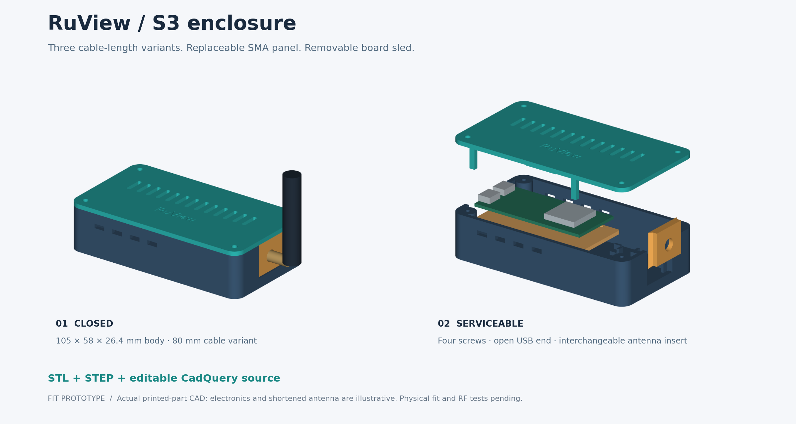
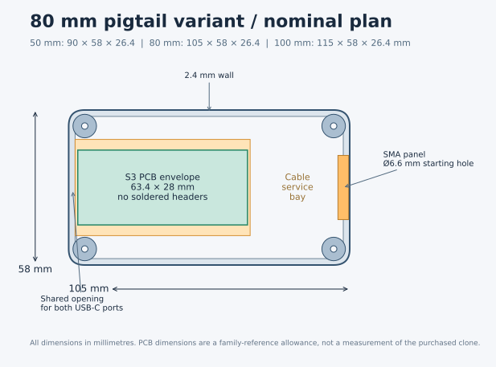

# Printable RuView receiver enclosures



Three **first-fit prototypes** for compatible ESP32-S3 N16R8 boards without
soldered headers and nominal **50, 80 and 100 mm IPX-to-SMA-K pigtails**.
Each has a removable board sled, a screw-fastened ventilated lid, a replaceable
antenna panel, access to both USB-C connectors and a rear cable service bay.
The normal base stands on a shelf; the alternative base adds two mounting ears.

**Print the fit coupon and sled first, then one complete case.** The exact board outline, connector stack and antenna dimensions must be
verified against the intended hardware. CAD checks are not a physical fit, thermal or RF test. Do not
print ten cases until the first one passes the acceptance steps below.

## Generate and print

- 50 mm variant: **90 × 58 × 26.4 mm** body.
- 80 mm variant: **105 × 58 × 26.4 mm** body.
- 100 mm variant: **115 × 58 × 26.4 mm** body.

Dimensions include the lid but exclude screw heads, cable plugs and antenna.
Mounting ears add 10 mm on one side of the case. Length variants enlarge the
rear service bay; the PCB remains beside the USB end. The length labels identify
the nominal cable, **not a certified cable-route fit**. Connector
length conventions and stiff end sections still need checking on the actual cable.

For one receiver, import these **individual STL files** into the slicer at
**100% scale, millimetres**:

1. One `base.stl` **or** `base-wall.stl`.
2. One `lid.stl` and one `sled.stl` from the same length variant.
3. One `panel-sma.stl`; use `panel-blank.stl` if drilling a custom connector hole.
4. Four copies of `spacer.stl`, placed only after checking the PCB underside.

`fit-coupon.stl` is a small test piece. The matching STEP files are editable CAD
solids. `assembly.step` shows assembled positions and contains a green reference
PCB named `REFERENCE_PCB_DO_NOT_PRINT`; it is **not a print plate**. Open an STL
in GitHub to rotate its model, or download it into a slicer.

Every individual STL/STEP is oriented for printing: base open side up, lid
outside face down with its internal fingers upward, antenna panel outside face
down, sled and spacers flat. The USB window is open at the top while printing,
so its wide roof is supplied by the separately printed lid. Side vents bridge
6 mm and tie-eyelet bores are 3 mm; inspect these small bridges in the slicer.
The antenna panel's flange grows outward at 45 degrees in its print orientation.

Suggested starting settings: **unfilled PETG**, 0.4 mm nozzle, 0.20 mm layers,
4 perimeters, 5 top/bottom layers and 20–30% infill. No designed support is
required; a brim may help the lid's long fingers. These are untested starting
settings, not a printer profile. Avoid metal or carbon-filled filament near the
antennas. PLA is suitable for a fit coupon; qualify the final material at the
actual operating temperature. This is a ventilated indoor enclosure with no IP
or child-resistance rating.

## Hardware and assembly

- Compatible bare ESP32-S3 board and the selected 50/80/100 mm pigtail.
- Compatible external antenna, with a mating SMA interface verified by inspection.
- Four **2.9 × 9.5 mm pan-head self-tapping screws**, starting pilot diameter
  2.4 mm; check thread fit in the coupon before using the case.
- Two narrow nylon cable ties, approximately 2.5 mm wide, and soft insulating
  pads. Add four small pieces of 1 mm nonconductive foam tape above the spacers.
- For the wall base: suitable mounting screws/anchors and washers for its two
  4 mm through-holes. Choose anchors for the actual wall, not from this CAD model.

1. With the board unpowered, test the coupon. Its large holes are 6.2, 6.6 and
   7.0 mm, left to right; its small holes are 2.2, 2.4 and 2.6 mm, bottom to top.
   Use the actual bulkhead and screw. A nut must seat flat with sufficient thread
   engagement; the hole does not determine SMA versus RP-SMA electrical mating.
2. Place the board on the sled, USB connectors facing its case opening. The
   drawing envelope is 63.4 × 28 mm. Four separate spacers plus 1 mm foam provide
   3 mm under the PCB. Position them under clear solder-mask areas, away from
   components, solder joints and pads. They are deliberately not fixed to assumed
   screw holes or assumed bare spots. If no safe support spots exist, revise the
   sled before installation.
3. Pass two ties through the sled's long side slots. Select clear paths on the
   board, cushion the contact areas and secure gently. Do not run a tie across
   BOOT/RST, the small RF connector, RGB LED, PCB antenna or components. Cut the
   tie tails. The 2 mm gap below the installed sled provides room for the ties.
4. Lower the sled onto its four base shelves. End/side stops locate it; four lid
   fingers later capture the sled with a nominal 0.4 mm vertical gap. The fingers
   contact the sled margins, not the PCB. Both USB ports must accept and release
   the actual cable plugs without moving or bending the board.
5. Fit the bulkhead into the removable panel **before** attaching the pigtail to
   the board. Hold the bulkhead body while tightening its own nut and washer;
   never transmit torque to the coax. The panel offers 2.4 mm material at the
   hole and a 16 mm diameter relief behind it. Check the connector's shoulder,
   nut, washer and wrench clearance, not just its nominal 6.6 mm starting hole.
6. Slide the panel down the rear guides. Connect the tiny RF plug vertically
   using the connector's proper procedure. Route slack into the rear bay without
   sharp bends, pulling at the plug or trapping cable beneath the lid. The two
   rear eyelets accept loose ties for strain relief; **do not cinch a tie onto
   the coax jacket**. Use its manufacturer's minimum bend radius. No guessed
   mandatory winding radius or number of loops is built into this case.
7. Close the lid with all four screws, gently and by hand. If it needs force,
   open it and inspect the panel, sled fingers and cable route. The 12 mm-deep
   blind pilot holes are not a reason to substitute long screws. The screws
   require approximately 7.1 mm engagement after the 2.4 mm lid.
8. Mount securely, then attach/support the antenna while holding the bulkhead.
   A long antenna is a lever: this untested panel is not a handle or a support
   for a heavy remote antenna. Keep its base and hinge clear of the lid and wall.

Removing the lid exposes BOOT/RST and allows the complete board sled to lift
out. There are no assumed-position button plungers to press a button by accident.
Do not assume the external RF path is active merely because the antenna fits;
verify the board RF routing against its schematic.

## Dimensions and input evidence



The reference board envelope is 63.4 × 28 mm without soldered headers.
It uses the manufacturer's [YD-ESP32-S3 metric drawing](https://github.com/vcc-gnd/YD-ESP32-S3/blob/b4ac4d60d1845a554bbbc7c97806ccb97cf08941/5-public-YD-ESP32-S3-Hardware%20info/ESP32-S3-Metric.pdf)
as a dimensional reference; the drawing itself is not redistributed. Clone
boards can differ. Measure the actual board and connector stack before printing.

The PCB thickness (1.6 mm), underside allowance (3 mm), upper component allowance
(7 mm), panel hole (6.6 mm), screw pilot (2.4 mm) and per-side sliding allowance
(0.4 mm) are **design starting values**. No antenna length, base diameter, hinge
sweep, bulkhead thread length or cable endpoint convention was verified. The preview's short antenna and electronic components are illustrative;
they are not dimensioned verified parts. Exact body clearance remains a fit test.

## Build, inspect and change the model

Use Python 3.12 in an isolated environment. CadQuery creates solid CAD geometry;
the generator exports STL/STEP, verifies each mesh and checks assembled solids
for overlap. Rendering uses those same solids, without a web service.

```sh
uv venv --python 3.12 /tmp/ruview-enclosure-cad
uv pip install --python /tmp/ruview-enclosure-cad/bin/python \
  --require-hashes --only-binary=:all: -r mechanical/enclosure/requirements.lock
/tmp/ruview-enclosure-cad/bin/python mechanical/enclosure/model.py
/tmp/ruview-enclosure-cad/bin/python mechanical/enclosure/render.py
/tmp/ruview-enclosure-cad/bin/python -m unittest discover \
  -s mechanical/enclosure/tests -v
```

Edit a JSON file in [profiles](profiles/) and rerun the generator. To keep an
experiment separate from the checked-in files:

```sh
/tmp/ruview-enclosure-cad/bin/python mechanical/enclosure/model.py \
  --profile mechanical/enclosure/profiles/pigtail-80.json \
  --output /tmp/ruview-enclosure-fit-trial
```

The profile controls enclosure length/width/height, nominal PCB outline,
underside space and hole/fit diameters. It does not automatically solve a cable
route from its length. Body length was selected to reserve progressively more
rear service space for the three nominal cable lengths. Changing a profile requires
rechecking the generated report, both USB plugs, the bulkhead stack and the
physical cable route. Rendered dimension labels describe the checked-in 80 mm
profile; regenerate or revise annotations if publishing a different nominal size.

`generated/*/validation.json` records per-part bounds, volume, triangle count,
single-body and watertight checks, STL hashes and assembly overlap volumes.
The report explicitly retains `physical_fit_verified: false`.

CI regenerates all variants and checks closed solids, mesh validity, assembly
clearances, archive contents and print orientations. A passing CAD check does
not establish physical fit or radio performance.

## First physical acceptance

The software preparation is complete when all CAD/mesh tests pass and the files
are pushed. Installed acceptance requires a real print and these observations:

1. Coupon holes fit the actual fasteners, and the PCB fits the sled with safe
   support and tie positions. Neither USB plug catches on plastic.
2. The panel slides without force and retains the actual bulkhead under gentle
   antenna adjustment. The antenna can be placed in its intended orientation
   without hitting the lid, mounting surface or power cable.
3. The selected pigtail reaches with slack, respects its cable bend specification
   and is not loaded when the lid closes or a USB plug is handled.
4. After power-up, compare temperature, RSSI, packet loss and CSI delivery with
   the previous unenclosed placement at the same AP/channel and orientation.
   Check again after a normal operating interval. Keep vents clear.
5. Revisit the sensing baseline after the enclosure/antenna placement changes.
   Mechanical assembly alone does not improve or validate presence, pose or fall
   detection. Record the accepted case profile and any dimensional corrections
   before printing the remaining receivers.
